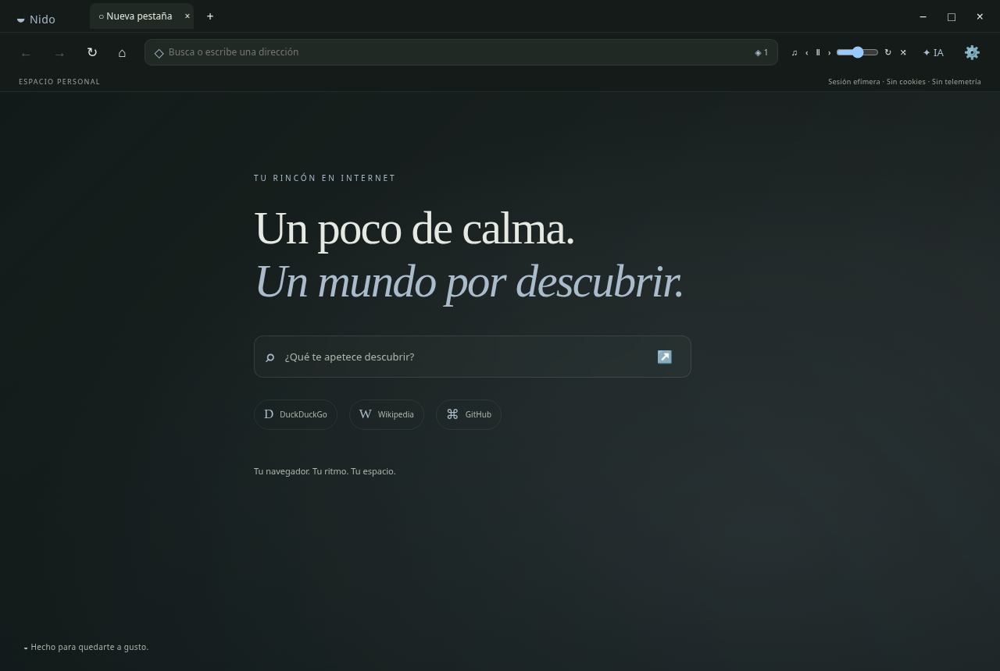

# ◒ Nido

Un navegador personal de escritorio con pestañas efímeras, una página de inicio
tranquila y asistentes de IA en una sesión separada. Electron **45.2.1** +
TypeScript + DOM nativo; sin framework de UI ni servicios propios.



**Versión publicada:** [v0.1.0](https://github.com/mpenagonzal-18/navegador-customizable-sin-anuncios/releases/tag/v0.1.0) ·
[Instalador Windows .exe](https://github.com/mpenagonzal-18/navegador-customizable-sin-anuncios/releases/download/v0.1.0/Nido.Setup.0.1.0.exe) ·
[macOS / Linux y checksums](https://github.com/mpenagonzal-18/navegador-customizable-sin-anuncios/releases/tag/v0.1.0).

> Proyecto inicial funcional. La interacción gráfica en Windows/macOS y los inicios de
> sesión de proveedores necesitan revisión en sus plataformas. No es un navegador
> auditado ni un sustituto de Tor. Captura de la interfaz ejecutada en Linux headless;
> capturas específicas de Windows/macOS y sidebar: pendientes.

## Correcciones de 0.1.1

- **Inicio de sesión:** en X u otra web que lo necesite, pulsa **Estricto** en la barra
  para activar **Temporal**. Permite cookies propias y almacenamiento en memoria
  para ese sitio; se borran al cerrar su última pestaña. No habilita cookies de terceros.
- **YouTube:** la caché de red se reutiliza en memoria y ya no se vacía cada 15 segundos.
  Si la web falla por necesitar almacenamiento, activa Temporal para youtube.com.
  Las exclusiones del bloqueador siguen intactas.
- **Barra de direcciones:** el primer clic selecciona toda la URL; los siguientes
  permiten colocar el cursor. Ctrl/Cmd+L sigue seleccionándola completa.

El modo estricto permanece por defecto. La compatibilidad es una elección por sitio,
no una garantía de acceso: CAPTCHA, OAuth externo o bloqueos de Electron pueden seguir
fallando. La regresión está probada con un login local, no con cuentas reales de X.

## Empezar

Requisitos: Node.js **24 LTS**, npm, Git y un sistema compatible con Electron 45.
Para el uso normal se necesita un escritorio gráfico. Linux requiere bibliotecas
GTK/NSS/ALSA y soporte de sandbox/user namespaces. No ejecutes Nido como root ni
uses `--no-sandbox` para resolver errores de instalación.

```sh
git clone https://github.com/mpenagonzal-18/navegador-customizable-sin-anuncios.git
cd navegador-customizable-sin-anuncios
npm install
npm run dev
```

`dev` compila y abre Electron; reinícialo tras cambios de código. `npm ci` reproduce
las versiones del lockfile. Electron 45 descarga su binario oficial al primer uso
si aún no está presente; en entornos Node 24 con proxy HTTP puede ser necesario
`NODE_USE_ENV_PROXY=1` (sin desactivar TLS). No se necesita ninguna API key.

| Comando             | Resultado                                    |
| ------------------- | -------------------------------------------- |
| `npm run dev`       | Build y ventana de escritorio                |
| `npm run build`     | Main, preloads y renderer en `dist/`         |
| `npm run lint`      | ESLint                                       |
| `npm run typecheck` | TypeScript estricto                          |
| `npm test`          | Vitest, sin cuentas ni red                   |
| `npm run smoke`     | Integración real, tres arranques de Electron |
| `npm run format`    | Prettier                                     |
| `npm run dist`      | Instaladores en `release/`                   |

## Navegación y memoria

- Abrir, cerrar, cambiar y arrastrar pestañas para reordenarlas; atrás, adelante,
  recargar e inicio. Una dirección sin protocolo usa HTTPS; el texto se busca.
- DuckDuckGo por defecto; Brave Search, Startpage o endpoint SearXNG configurable.
- Las pestañas inactivas se descargan tras 10 minutos por defecto (configurable,
  revisión cada 30 s). Volver recarga la última URL; no conserva formularios ni
  historial atrás/adelante de la vista suspendida.
- La página nueva se dibuja en la UI existente; no crea un renderer extra. La IA
  se crea bajo demanda. La música sigue en la UI al suspender o cambiar vistas.

| Atajo                             | Acción                     |
| --------------------------------- | -------------------------- |
| Ctrl/Cmd+T                        | Nueva pestaña              |
| Ctrl/Cmd+W                        | Cerrar pestaña             |
| Ctrl/Cmd+L                        | Seleccionar dirección      |
| Ctrl/Cmd+R                        | Recargar                   |
| Ctrl/Cmd+Tab / Ctrl/Cmd+Shift+Tab | Pestaña siguiente/anterior |
| Ctrl/Cmd+Shift+A                  | Mostrar/ocultar IA         |

Bundle renderer medido con esbuild: **13,24 kB JS** (5,12 kB gzip), más unos
**8,62 kB CSS**. El main propio ronda 51 kB; Ghostery y Zod se conservan como módulos
de ejecución. Estas cifras **no** son el tamaño de Electron ni el consumo RAM:
Chromium domina el instalador y cada página remota usa procesos propios. La UI estuvo
lista en aproximadamente **0,9 s** en esta máquina Linux headless con perfil de
prueba; no es una garantía ni una medida de arranque en frío de otras plataformas.

## Privacidad y bloqueo

Sin telemetría, auto-update, crash reporter ni fuentes externas. La página de inicio
no hace peticiones de red. Las páginas que abres pueden hacer peticiones y mantener
conexiones de fondo. Nido no promete que todas las conexiones posteriores correspondan
a un clic individual: son las propias webs las que cargan sus recursos.

Las pestañas usan una sesión **en memoria**, sin caché en disco ni historial
persistente por defecto. Se bloquean cookies de red y `document.cookie`; se pueden
permitir solo para el sitio propio durante la ejecución actual; los terceros
siguen bloqueados. Las APIs de almacenamiento y los service workers se deniegan,
con limpieza adicional cada 15 segundos, por origen al cerrar pestañas y completa
antes de salir. Se envían DNT/GPC, se recorta Referer y
se limita WebRTC. Los permisos parten de denegación y los admitidos requieren una
confirmación por sitio. El historial opcional es un JSON exclusivamente local.
No hay gestor de descargas web en esta versión.

EasyList + EasyPrivacy se empaquetan localmente. La actualización requiere pulsar
**Actualizar listas manualmente**. Se bloquean anuncios/rastreadores de red y banners
por CSS; no se ejecutan scriptlets. El contador ◈ es por pestaña, solo en memoria;
pulsarlo desactiva/reactiva el bloqueo del sitio actual para esta ejecución.

**Excepción de vídeo:** youtube.com, youtu.be, googlevideo.com, ytimg.com y
youtube-nocookie.com y sus subdominios evitan completamente el motor, CSS y scripts
del bloqueador. La lista se edita en ajustes. Las peticiones `media` tampoco se
bloquean en otros sitios. EasyList no separa perfectamente scripts de banners y de
vídeo en todos los servicios: añade una exclusión si un reproductor se ve afectado.
El bloqueo de cookies es independiente y puede limitar YouTube.

Consulta [PRIVACY](docs/PRIVACY.md) para almacenamiento, terceros, límites de red y
rastros del sistema operativo; [SECURITY](SECURITY.md) para el modelo de seguridad.

## Sidebar de IA

Claude, ChatGPT, Gemini, Perplexity y Mistral Le Chat vienen preconfigurados con
iconos locales. Abre **✦ IA**, selecciona proveedor y arrastra el borde del panel;
también puedes usar las flechas con el separador enfocado. Ajustes permite cambiar
lado/ancho, añadir nombre+URL+icono, quitar y reordenar proveedores, y descargar
vistas tras un tiempo sin uso (0 = conservar). Open WebUI puede añadirse con
`http://localhost:3000`; para Ollama utiliza una UI web local.

Cada proveedor tiene su `WebContentsView`, conservada al cambiar u ocultar. Comparten
**solo entre los asistentes** `persist:ai-sidebar`; las pestañas normales nunca la
usan. Sus cookies/almacenamiento persisten solo para los dominios configurados y
sus subdominios, sin autorizar automáticamente dominios padres. Los frames de terceros
no configurados se bloquean. Los enlaces fuera del proveedor abren una pestaña normal.
El botón **Borrar datos de la sidebar de IA** limpia esa sesión; cambiar o retirar
un proveedor también la limpia completa para no conservar dominios retirados.

Se usa el User-Agent estándar de Chrome. Aun así, **Google puede bloquear Gemini**
por tratarse de Electron y porque su OAuth requiere dominios/cookies ajenos al host
configurado. No se garantiza ningún inicio de sesión ni se simula compatibilidad.
La alternativa es ese servicio en el navegador habitual o una UI local como Open
WebUI. Las vistas no comparten cookies con el navegador del sistema.

El menú contextual ofrece **Copiar texto seleccionado para la IA** y **Copiar URL de
la página actual**: solo copian al portapapeles. Nido nunca envía contenido a ningún
asistente automáticamente. Los servicios de IA tienen sus propias políticas de
privacidad. El dictado puede pedir micrófono con confirmación explícita.

## Personalizar

En ⚙: acento y tema claro/oscuro/automático, fondo sólido/degradado/imagen local con
desenfoque y oscurecimiento. Los cambios se ven al instante y se guardan en
`userData/settings.json`. Hay vista previa, restablecer e importar/exportar JSON.
Los archivos no se suben; el JSON puede contener rutas locales, pero no cookies.

En ♫ selecciona mp3, ogg, wav o flac locales. Controles de reproducción/pausa,
anterior/siguiente, volumen, bucle de lista y aleatorio. Activa **Recordar lista**
para recuperar las rutas tras reiniciar; nunca comienza a sonar automáticamente.
Los archivos movidos o borrados deberán volver a seleccionarse.

Para renombrar el navegador cambia `APP_NAME` en `src/shared/config.ts`. Para los
instaladores ajusta también `build.productName`, `build.appId` y los metadatos de
`package.json` (identidad del producto, no lógica de navegación).

## Empaquetar y publicar

```sh
npm run dist
```

En el host correspondiente genera NSIS (.exe), DMG/ZIP o AppImage/DEB. Los workflows
[CI](.github/workflows/ci.yml) comprueban lint, tipos, pruebas, build e integración,
y empaquetado en tres sistemas. [Release](.github/workflows/release.yml) genera
instaladores al publicar un tag `v*` y publica la release con todos los instaladores y sus checksums, después de
superar los controles y construir en las tres plataformas.
Configura firma y notarización antes de una distribución pública de confianza.
Los artefactos de ejemplo no están firmados.

El repositorio local ya tiene `main` y commits por fase. Si vas a crear otro repo:

```sh
gh repo create TU_USUARIO/nido --public --source=. --push
```

Si Git indica que `origin` ya existe, crea el nuevo repositorio sin `--source`,
configura su URL con `git remote set-url origin https://github.com/TU_USUARIO/nido.git`
y ejecuta `git push -u origin main`. Para el repositorio original ya conectado:

```sh
git push -u origin main
git tag v0.1.0
git push origin v0.1.0
```

Alternativa manual: crea un repositorio vacío en GitHub, copia su URL, configura
`origin` (con `git remote add origin URL` si falta, o `set-url` si existe) y haz
`git push -u origin main`. La versión **v0.1.0** ya está publicada. Consulta [la evidencia de publicación](docs/PUBLICATION.md).

[Arquitectura](docs/ARCHITECTURE.md) · [Validación y límites](docs/VALIDATION.md) ·
[Contribuir](CONTRIBUTING.md) · [Licencias de terceros](docs/THIRD_PARTY.md)

Código propio MIT. Las listas y dependencias conservan sus licencias originales.
